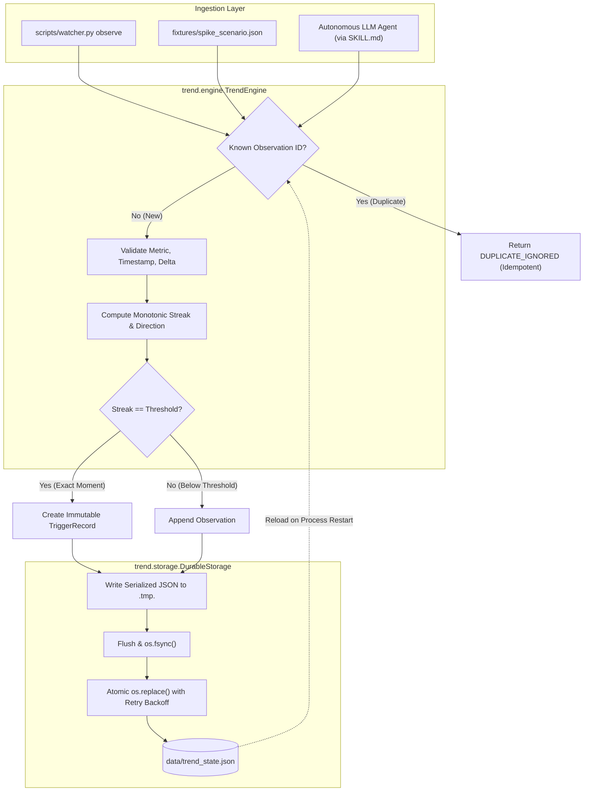

# Pharos Trend Watcher (`pharos-trend-watcher`)

> **Pharos Trend Watcher**  
> Persistent, multi-observation trend monitoring with auditable history.  
> Official Task: [Trend Watcher](https://pharos-agent-arena.vercel.app/tasks/trend-watcher) | Author: [`JimmyOgb`](https://github.com/JimmyOgb) | License: MIT  

---

## 1. Project Overview

**Pharos Trend Watcher** is an intelligent, memory-enabled decision skill for the Pharos blockchain ecosystem and the emerging agentic economy. 

Autonomous agents that monitor volatile on-chain metrics (such as gas prices, liquidity pool Total Value Locked, or DEX exchange rates) often fail when reacting to single, noisy readings or flash spikes. A transient -60% crash or a momentary oracle glitch must not cause an agent to panic-rebalance, liquidate, or dump assets.

Pharos Trend Watcher solves this by establishing **durable memory across separate process runs**, tracking consecutive directional movements, and acting **only once a trend is confirmed across a configurable multi-observation threshold ($\ge 3$)**.

---

## 2. Official Task & Requirements

The official challenge specification defines five mandatory acceptance criteria:

| Requirement ID | Official Requirement Text | Engineering Translation |
|:---:|---|---|
| **01** | **Stores state between runs: persistent storage, not just in-memory.** | Observations, configuration, and trigger events are saved to non-volatile disk storage using atomic write semantics, surviving process death and reboots. |
| **02** | **Trend rule needs at least 3 observations to trigger and is configurable.** | Configurable threshold $K$ with hard validation enforcing $K \ge 3$. Downward or upward monotonic trend direction rules. |
| **03** | **Handles restarts without losing or duplicating history.** | State is reloaded cleanly on process restart. Observations and trigger records feature stable deterministic IDs that reject duplicate submissions idempotently. |
| **04** | **Shows the stored history and the exact moment the trend condition was met.** | Transparent chronological history table, active streak counters, and immutable trigger event records capturing the triggering observation ID, timestamp, and rationale. |
| **05** | **Demonstrates that a single spike does not trigger it.** | Reproducible 8-observation negative test proving an isolated -60.8% sudden drop fails to trigger the engine, whereas 3 sustained consecutive drops trigger as expected. |

---

## 3. Architecture & Execution Flow

The project is structured around a deterministic core engine, durable atomic storage, and reviewer-friendly CLI inspection tools:



### Component Responsibilities
- `trend/config.py`: Strict validation of trend thresholds ($\ge 3$), directional enums (`DOWNWARD`, `UPWARD`), and interval constraints.
- `trend/storage.py`: Atomic persistence workflow (`.tmp` $\to$ `flush` $\to$ `fsync` $\to$ `os.replace`), state validation, and automatic forensic quarantine of corrupted files.
- `trend/engine.py`: Deterministic streak and delta calculation, single-spike resistance, reversal handling, and trigger idempotency.
- `trend/inspector.py`: Human-readable ASCII formatting and structured JSON export of chronological history and trigger moments.
- `scripts/watcher.py`: Reviewer CLI providing `observe`, `history`, `status`, `verify-spike`, and `demo`.

---

## 4. Installation & Prerequisites

### Prerequisites
- Python 3.9+ (tested on Python 3.12.10)
- `pytest` (optional, for running the automated test suite)

### Setup
```bash
# Clone or navigate to the project directory
cd skills/pharos-trend-watcher

# (Optional) Create and activate a virtual environment
python -m venv .venv
source .venv/bin/activate  # On Windows: .venv\Scripts\activate

# Install dependencies (zero external runtime dependencies required)
pip install -e .
pip install pytest
```

---

## 5. Configuration & Trend Semantics

### Trend Direction & Threshold Semantics
- **Threshold ($K$)**: Defined as the number of consecutive qualifying readings participating in the trend.
  - **Minimum Threshold**: $K \ge 3$. Setting $K < 3$ raises `TrendConfigurationError`.
  - For a downward trend with threshold $K=3$: $R_1 > R_2 > R_3$.
    - Reading 1 ($R_1$): Baseline reading. Active streak = 1. Condition not met ($1 < 3$).
    - Reading 2 ($R_2 < R_1$): First downward drop. Active streak = 2. Condition not met ($2 < 3$).
    - Reading 3 ($R_3 < R_2$): Second downward drop. Active streak = 3. **Condition MET ($3 \ge 3$) $\to$ TRIGGER!**
- **Strict Monotonicity**:
  - `strict_monotonic: True` (default): An unchanged reading ($V_i == V_{i-1}$) breaks the trend and resets the streak to 1.
- **Reversals**:
  - In a downward trend, an upward movement ($V_i > V_{i-1}$) immediately breaks the streak and resets it to 1.
- **Interval Limits**:
  - `max_interval_seconds`: If elapsed time between observations exceeds this threshold (default: 3600s), the streak resets to 1 to prevent bridging disconnected time periods.

---

## 6. Persistent Storage & Restart Recovery

### Atomic File Writes
To protect against file corruption caused by abrupt process termination or power loss, state is never directly overwritten in place:
1. State is serialized and written to a unique temporary file: `data/trend_state.json.tmp.<uuid>`.
2. The runtime buffer is explicitly flushed (`file.flush()`).
3. Changes are committed to physical media via `os.fsync(file.fileno())`.
4. The temporary file atomically replaces the destination file via `os.replace()`.

### Windows NTFS Resilience
On Windows NTFS, file indexing or antivirus scanners can momentarily lock open files. `DurableStorage` implements a 5-attempt retry backoff with linear backoff (50ms increments) to ensure atomic replacement succeeds without transient collisions.

### Corruption Quarantine
If a state file contains invalid JSON or schema violations:
- The engine does **not** erase the file.
- The damaged file is automatically renamed to `data/trend_state.json.corrupted.<timestamp>` to preserve forensic evidence for reviewers.
- A `CorruptedStateError` is raised.

---

## 7. Duplicate Prevention & Idempotency

### Deterministic Observation IDs
Each observation is assigned a deterministic 16-hex identifier:
$$\text{ID} = \text{SHA256}(\text{metric} + ":" + \text{ISO\_timestamp} + ":" + \text{value})[:16]$$
External data providers can also specify a custom unique transaction hash or sequence identifier.

### Deduplication
- Re-ingesting an observation with an identical ID returns `status: "DUPLICATE"` and message `"Observation with ID '...' has already been processed. Deduplicated."`
- The observation array is **not** duplicated.
- Active streak calculations are **not** inflated.

### Trigger Idempotency
- Trigger records are assigned a unique trigger ID based on their qualifying observation window:
  $$\text{Trigger ID} = \text{trig\_} + \text{SHA256}(\text{qualifying\_ids})[:12]$$
- Subsequent readings in an ongoing trend or replayed observations do not produce duplicate trigger events.

---

## 8. CLI Usage

The reviewer-facing CLI is located at `scripts/watcher.py`.

```bash
# 1. View current status
python scripts/watcher.py status

# 2. Ingest an observation
python scripts/watcher.py observe --value 100.0 --id obs_01

# 3. View chronological history and confirmed triggers
python scripts/watcher.py history

# 4. Run the official single-spike negative verification test
python scripts/watcher.py verify-spike

# 5. Run the comprehensive end-to-end demonstration walkthrough
python scripts/watcher.py demo
```

---

## 9. History & Trigger Inspection

The `history` command outputs a chronological audit table showing every recorded reading, delta, active streak, and trigger flag:

```text
#    | Obs ID           | Timestamp (UTC)          | Value      | Delta      | Streak | Triggered?
------------------------------------------------------------------------------------------------------
1    | obs_spike_01     | 2026-10-24T10:00:00.000  | 100.00     | -          | 1      | no
2    | obs_spike_02     | 2026-10-24T10:01:00.000  | 102.00     | +2.00      | 1      | no
3    | obs_spike_03     | 2026-10-24T10:02:00.000  | 40.00      | -62.00     | 2      | no
4    | obs_spike_04     | 2026-10-24T10:03:00.000  | 99.00      | +59.00     | 1      | no
5    | obs_spike_05     | 2026-10-24T10:04:00.000  | 100.00     | +1.00      | 1      | no
6    | obs_spike_06     | 2026-10-24T10:05:00.000  | 94.00      | -6.00      | 2      | no
7    | obs_spike_07     | 2026-10-24T10:06:00.000  | 88.00      | -6.00      | 3      | YES [CONFIRMED]
8    | obs_spike_08     | 2026-10-24T10:07:00.000  | 81.00      | -7.00      | 4      | no
```

---

## 10. Single-Spike Negative Test (Requirement 05)

Requirement 05 mandates proving that an isolated extreme anomaly does not cause a premature trigger.

The test sequence defined in `fixtures/spike_scenario.json` demonstrates this conclusively:
1. **Reading 1 ($100.0$)**: Baseline established $\to$ Streak = 1.
2. **Reading 2 ($102.0$)**: Slight upward noise $\to$ Streak = 1.
3. **Reading 3 ($40.0$) [EXTREME SPIKE: -60.8%]**: First downward drop. Streak = 2. Threshold is 3 $\to$ **NO TRIGGER**.
4. **Reading 4 ($99.0$) [IMMEDIATE RECOVERY: +147.5%]**: Upward move breaks downward streak. Streak resets to 1 $\to$ **NO TRIGGER**.
5. **Reading 5 ($100.0$)**: Normal baseline $\to$ Streak = 1.
6. **Reading 6 ($94.0$)**: Qualifying drop 1 $\to$ Streak = 2.
7. **Reading 7 ($88.0$)**: Qualifying drop 2 $\to$ Streak = 3 $\to$ **TRIGGER CONFIRMED!**

Run this test via:
```bash
python scripts/watcher.py verify-spike
```

Expected output:
```text
======================================================================
PHAROS TREND WATCHER — REQUIREMENT 05 SINGLE-SPIKE VERIFICATION
======================================================================
Loaded Scenario: Synthetic 8-observation test scenario demonstrating single-spike resistance...
Configured Threshold: 3 (Must require >= 3 observations)
----------------------------------------------------------------------
Step  | Obs ID         | Val      | Streak | Trig?  | Audit Note
----------------------------------------------------------------------
1     | obs_spike_01   | 100.00   | 1      | no     | Baseline established
2     | obs_spike_02   | 102.00   | 1      | no     | Slight upward noise; resets streak
3     | obs_spike_03   | 40.00    | 2      | no     | EXTREME ISOLATED SPIKE (-60.8%); MUST NOT TRIGGER
4     | obs_spike_04   | 99.00    | 1      | no     | IMMEDIATE RECOVERY (+147.5%); MUST NOT TRIGGER
5     | obs_spike_05   | 100.00   | 1      | no     | Normalized baseline reading
6     | obs_spike_06   | 94.00    | 2      | no     | Qualifying downward drop 1 (streak=2/3)
7     | obs_spike_07   | 88.00    | 3      | YES    | REACHES THRESHOLD 3 -> TRIGGER CONFIRMED
8     | obs_spike_08   | 81.00    | 4      | no     | Continued trend drop; does not duplicate trigger
----------------------------------------------------------------------
VERDICT: PASS — Single -60.8% spike resisted; 3 consecutive drops triggered.
```

---

## 11. Automated Test Instructions

The test suite runs against the production engine, including separate operating-system subprocess restarts.

```bash
# Run the complete test suite (disabling conflicting third-party plugins)
python -m pytest -p no:gltest tests/ -v
```

### Verified Test Suite Results (46/46 Passed)
```text
============================= test session starts =============================
platform win32 -- Python 3.12.10, pytest-9.1.1, pluggy-1.6.0
rootdir: C:\Users\NO GO NO\PharosBuild\skills\pharos-trend-watcher
configfile: pyproject.toml
collected 46 items

tests/test_cli.py::test_cli_help PASSED                                  [  2%]
tests/test_cli.py::test_cli_observe_validation_error PASSED              [  4%]
tests/test_cli.py::test_cli_status_formatted PASSED                      [  6%]
tests/test_cli.py::test_cli_history_formatted PASSED                     [  8%]
tests/test_cli.py::test_cli_verify_spike_command PASSED                  [ 10%]
tests/test_cli.py::test_cli_demo_command PASSED                          [ 13%]
tests/test_config.py::test_valid_default_configuration PASSED            [ 15%]
tests/test_config.py::test_valid_custom_configuration PASSED             [ 17%]
tests/test_config.py::test_threshold_below_three_rejected[2] PASSED      [ 19%]
tests/test_config.py::test_threshold_below_three_rejected[1] PASSED      [ 21%]
tests/test_config.py::test_threshold_below_three_rejected[0] PASSED      [ 23%]
tests/test_config.py::test_threshold_below_three_rejected[-1] PASSED     [ 26%]
tests/test_config.py::test_threshold_below_three_rejected[-5] PASSED     [ 28%]
tests/test_config.py::test_threshold_non_integer_rejected[three] PASSED  [ 30%]
tests/test_config.py::test_threshold_non_integer_rejected[3.5] PASSED    [ 32%]
tests/test_config.py::test_threshold_non_integer_rejected[True] PASSED   [ 34%]
tests/test_config.py::test_threshold_non_integer_rejected[False] PASSED  [ 36%]
tests/test_config.py::test_threshold_non_integer_rejected[None] PASSED   [ 39%]
tests/test_config.py::test_threshold_non_integer_rejected[invalid_type5] PASSED [ 41%]
tests/test_config.py::test_invalid_metric_name_rejected[] PASSED         [ 43%]
tests/test_config.py::test_invalid_metric_name_rejected[   ] PASSED      [ 45%]
tests/test_config.py::test_invalid_metric_name_rejected[None] PASSED     [ 47%]
tests/test_config.py::test_direction_string_coercion PASSED              [ 50%]
tests/test_config.py::test_invalid_max_interval_rejected PASSED          [ 52%]
tests/test_config.py::test_config_serialization_roundtrip PASSED         [ 54%]
tests/test_engine.py::test_initial_observation_no_trigger PASSED         [ 56%]
tests/test_engine.py::test_two_observations_do_not_trigger_three_observation_rule PASSED [ 58%]
tests/test_engine.py::test_three_qualifying_observations_trigger_at_exact_threshold PASSED [ 60%]
tests/test_engine.py::test_threshold_greater_than_three_works_correctly PASSED [ 63%]
tests/test_engine.py::test_reversal_breaks_streak_and_resets PASSED      [ 65%]
tests/test_engine.py::test_flat_reading_strict_monotonic_resets_streak PASSED [ 67%]
tests/test_engine.py::test_out_of_order_timestamp_rejected PASSED        [ 69%]
tests/test_engine.py::test_excessive_time_gap_resets_streak PASSED       [ 71%]
tests/test_engine.py::test_upward_trend_configuration PASSED             [ 73%]
tests/test_idempotency.py::test_reprocessing_observation_does_not_duplicate_history PASSED [ 76%]
tests/test_idempotency.py::test_re_executing_after_trigger_does_not_duplicate_trigger_record PASSED [ 78%]
tests/test_idempotency.py::test_deterministic_observation_ids PASSED     [ 80%]
tests/test_idempotency.py::test_deterministic_trigger_ids PASSED         [ 82%]
tests/test_restart_process.py::test_process_restart_preserves_history_and_streak PASSED [ 84%]
tests/test_spike.py::test_single_spike_does_not_trigger_using_fixture PASSED [ 86%]
tests/test_spike.py::test_isolated_massive_crash_isolated_step PASSED    [ 89%]
tests/test_storage.py::test_atomic_write_creates_valid_state PASSED      [ 91%]
tests/test_storage.py::test_corrupted_state_quarantined_not_erased PASSED [ 93%]
tests/test_storage.py::test_invalid_schema_quarantined PASSED            [ 95%]
tests/test_storage.py::test_missing_file_initializes_empty_state PASSED  [ 97%]
tests/test_storage.py::test_trigger_record_persistence PASSED            [100%]

============================= 46 passed in 7.09s ==============================
```

---

## 12. Example Observation Sequence & Expected Behavior

Here is an illustrative walkthrough of state transitions in a downward trend ($K=3$):

```text
1. Ingest V=100.0  -> Delta: None   | Streak: 1 / 3 | Triggered: NO
2. Ingest V=96.0   -> Delta: -4.0   | Streak: 2 / 3 | Triggered: NO
3. Ingest V=96.0   -> Delta:  0.0   | Streak: 1 / 3 | Triggered: NO  (Flat reading resets strict streak)
4. Ingest V=92.0   -> Delta: -4.0   | Streak: 2 / 3 | Triggered: NO
5. Ingest V=87.0   -> Delta: -5.0   | Streak: 3 / 3 | Triggered: YES (EXACT MOMENT)
6. Ingest V=87.0   -> [DUPLICATE]   | Streak: 3 / 3 | Triggered: NO  (Ignored idempotently)
7. Ingest V=82.0   -> Delta: -5.0   | Streak: 4 / 3 | Triggered: NO  (Trend active; no duplicate trigger)
```

---

## 13. Repository Structure

```text
pharos-trend-watcher/
├── .gitignore
├── LICENSE
├── pyproject.toml
├── README.md
├── SKILL.md
├── data/
│   └── trend_state.json
├── fixtures/
│   └── spike_scenario.json
├── scripts/
│   └── watcher.py
├── tests/
│   ├── test_cli.py
│   ├── test_config.py
│   ├── test_engine.py
│   ├── test_idempotency.py
│   ├── test_restart_process.py
│   ├── test_spike.py
│   └── test_storage.py
└── trend/
    ├── __init__.py
    ├── config.py
    ├── engine.py
    ├── inspector.py
    └── storage.py
```

---

## 14. Known Limitations

1. **Multi-Process Concurrency**:
   - Atomic file replacement (`os.replace`) guarantees single-process crash consistency. If multiple worker processes write to the exact same file simultaneously, external process mutex or database locking would be required. In single-agent cron setups, this limitation is safely avoided.
2. **Volatile In-Memory Fallback**:
   - The engine does not provide an in-memory-only fallback; durable storage is intentionally mandatory in compliance with Requirement 01.

---

## 15. Requirement-to-Code-to-Test Verification Matrix

| Official Requirement | Primary Component | Primary Test Verification | Status |
|---|---|---|:---:|
| **01: Persistent Storage** | `trend/storage.py` | `tests/test_restart_process.py::test_process_restart_preserves_history_and_streak` | **VERIFIED (PASS)** |
| **02: Configurable Threshold ($\ge 3$)** | `trend/config.py`, `trend/engine.py` | `tests/test_config.py::test_threshold_below_three_rejected`<br>`tests/test_engine.py::test_threshold_greater_than_three_works_correctly` | **VERIFIED (PASS)** |
| **03: Safe Restart & Duplicate Handling** | `trend/engine.py`, `trend/storage.py` | `tests/test_idempotency.py::test_reprocessing_observation_does_not_duplicate_history`<br>`tests/test_storage.py::test_corrupted_state_quarantined_not_erased` | **VERIFIED (PASS)** |
| **04: Visible History & Exact Moment** | `trend/inspector.py`, `trend/engine.py` | `tests/test_engine.py::test_three_qualifying_observations_trigger_at_exact_threshold`<br>`tests/test_cli.py::test_cli_history_formatted` | **VERIFIED (PASS)** |
| **05: Single Spike Negative Test** | `fixtures/spike_scenario.json`, `trend/engine.py` | `tests/test_spike.py::test_single_spike_does_not_trigger_using_fixture`<br>`tests/test_cli.py::test_cli_verify_spike_command` | **VERIFIED (PASS)** |

---

## 16. Verification & Demonstration Plan

For the official submission on [Pharos Agent Arena](https://pharos-agent-arena.vercel.app/tasks/trend-watcher):
- **Proof Link**: A live interactive web interface hosted on Vercel (`https://pharos-trend-watcher.vercel.app`) allowing evaluators to verify spike resistance, persistence, and trend triggers directly in their browser.
- **Repository Link**: Public GitHub repository at `https://github.com/JimmyOgb/pharos-trend-watcher`.
- **Walkthrough Video**: A continuous 1080p narrated video generated via Playwright browser automation + edge-tts voiceover demonstrating all 5 acceptance criteria.
